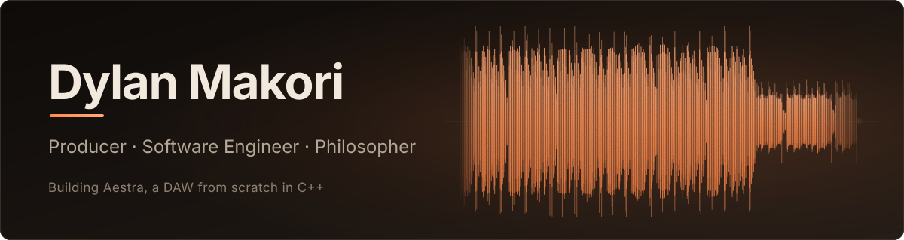
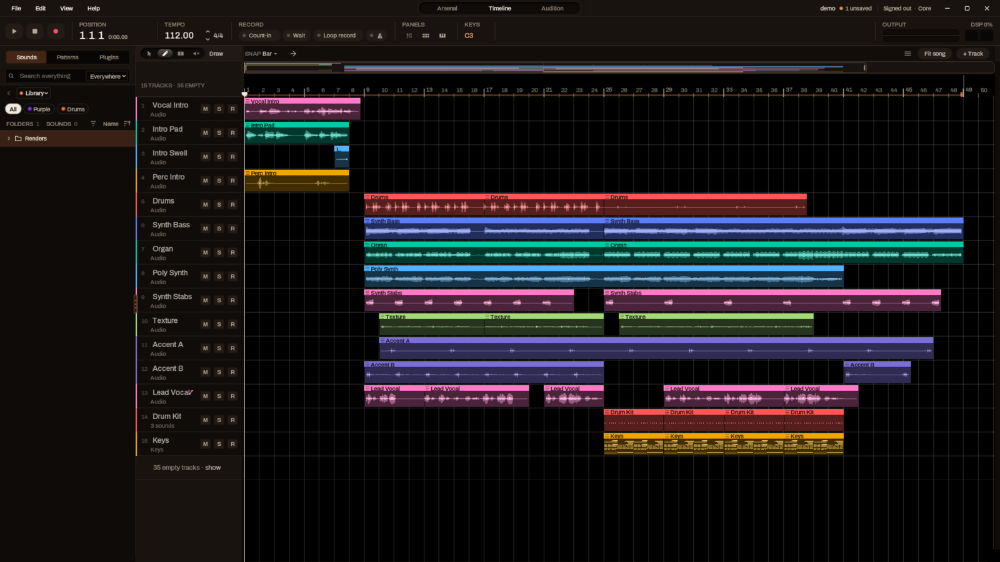
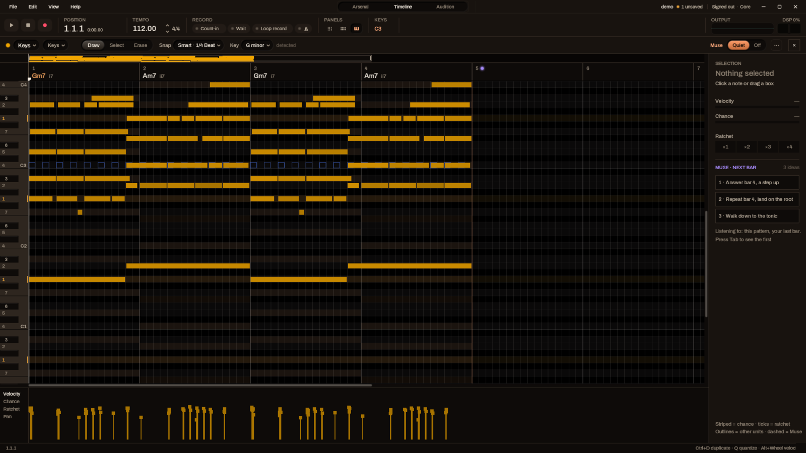

<em>Create like the silence is watching.</em>

## Hi, I'm Dylan

I make and enjoy music, write software, and I think a lot about why those two feel so alike. Both are about deciding what goes in the silence.

Right now that is one project: **Aestra**, a DAW I'm building from scratch in C++17 for the old laptops and machines that music software usually forgets about.

I'm a year in, working across **design**, **DSP** and **C++**. I'd rather ship one thing I understand end to end than five things I borrowed.

 

## Currently building

Aestra in the Solace theme. A 15-track arrangement of real stems.

**[Aestra](https://github.com/currentsuspect/Aestra)** is a digital audio workstation with its own UI stack (OpenGL), its own audio engine (RtAudio), VST3 hosting, a step-sequencer rack, a mixer, and a scriptable control surface called Muse. It is in alpha. Public beta is **25 December 2026** on Windows and Linux.

The piano roll names the chords as you write, and Muse offers ideas for the next bar.

  
  
  

 

## What I work with

  
  
  
  
  
  

  
  
  
  
  

 

## Things I've made

| | |
| --- | --- |
| **[Aestra](https://github.com/currentsuspect/Aestra)** | A DAW built from scratch in C++17. The main thing. |
| **[Aestra website](https://github.com/currentsuspect/Aestra-website)** | The site at [aestra.studio](https://aestra.studio), written in plain language on purpose. |
| **[Tunes](https://github.com/currentsuspect/tunes)** | A self-hosted music player: a Flutter app plus a daemon that runs on a home machine. |
| **[PlainSight Digital](https://github.com/currentsuspect/plainsight-digital)** | A small studio for web, mobile and desktop work. |

 

## How I try to work

- **Keep it small.** A tool that runs on a tired old laptop is a better tool everywhere else too.
- **Make it understand you.** Software should meet people where they already are, not teach them its vocabulary first.
- **Fun, not fighting.** If the interface wins the argument, the music loses.
- **Read the numbers, then trust your ears.** Measure first. Then listen, because the listening is the point.

 

  Producer · Software Engineer · Philosopher

